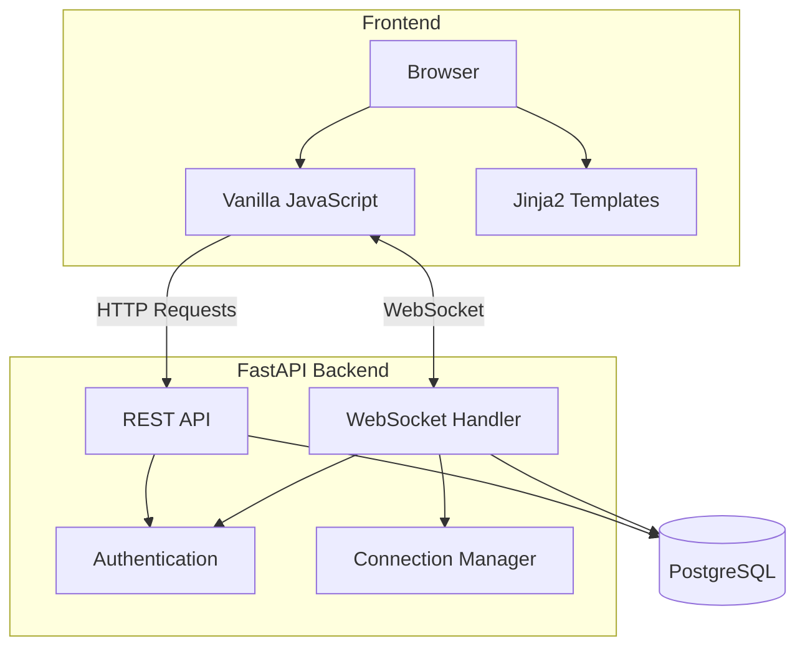
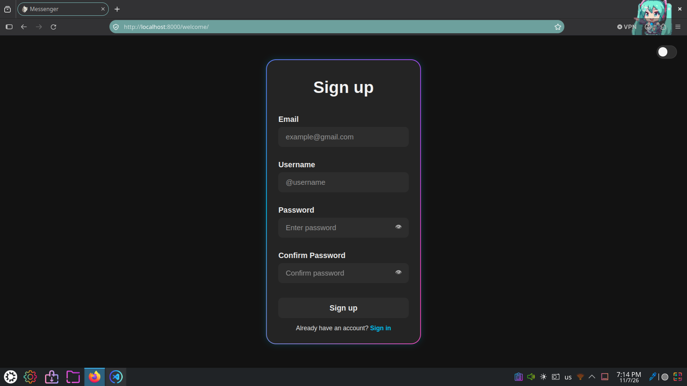
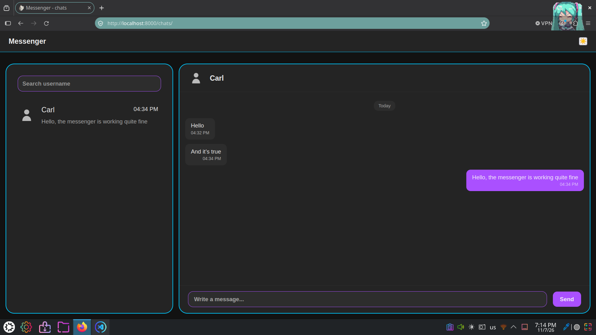
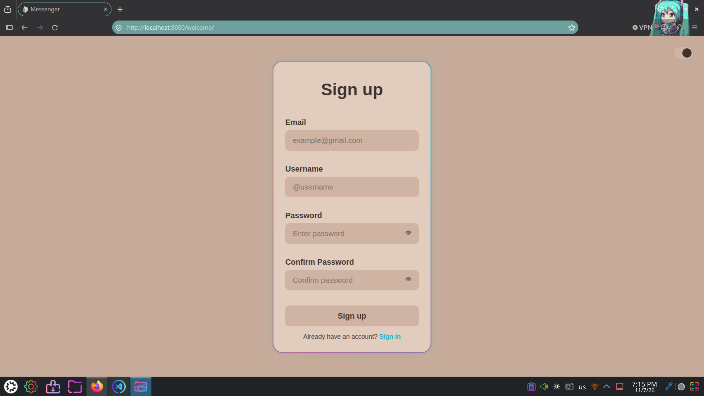

# Messenger

A real-time messaging application built with Python and FastAPI.

The project provides user authentication, user discovery, private conversations and real-time message exchange through WebSockets.

The application is built with a focus on backend architecture, asynchronous communication, database management and automated testing.

# Features

## Authentication and User Management

* User authentication and login.
* Password hashing using **Argon2**.
* JWT-based authentication with access and refresh tokens.
* HTTP-only cookie-based authentication.
* Automatic access token renewal.
* Refresh session validation and expiration checks.
* Username validation and availability checking.
* User search by username.

## Messaging

* Private one-to-one conversations.
* Automatic reuse of existing conversations.
* Real-time message exchange using WebSockets.
* Persistent message storage in PostgreSQL.
* Paginated message history retrieval.
* Cursor-based pagination for loading older messages.
* Access control for chat participants.
* Support for multiple active WebSocket connections per user.

## Frontend 

* Dynamic user interface built with HTML, CSS and Vanilla JavaScript.
* Registration and Login forms with client-side validation.
* Dynamic chat list and chat navigation.
* Debounced user search.
* Real-time message rendering.
* Infinite scrolling for message history.
* Scroll position preservation when loading older messages.
* Light and dark theme switching on the authentication page.

## Infrastructure & Development 

* Asynchronous database operations using **SQLAlchemy**.
* Database migrations with **Alembic**.
* Containerized environment using **Docker** and **Docker Compose**.
* Persistent data storage using Docker volumes.
* Automated tests with **PyTest**.
* Continuous Integration using **GitHub Actions**.

# Architecture

Messenger follows a client-service architecture consisting of three main components:

* **Frontend**: HTML, CSS, Vanilla JavaScript and Jinja2 templates;
* **Backend**: FastAPI application providing REST API endpoints and WebSocket communication;
* **Database**: PostgreSQL accessed asynchronously through SQLAlchemy;

## Structure:



## Backend Structure

The backend is organized into several modules based on their responsibilities:

* `api/` - HTTP endpoints and WebSocket handlers;
* `database/` - Database configuration, SQLAlchemy engine and ORM models;
* `schemas/` - Request validation using Pydantic;
* `utils/` - Authentication utilities, password hashing, token management and WebSocket connection management;

FastAPI dependency injection is used to provide database sessions and authenticate users across HTTP and WebSocket endpoints.

## Frontend Structure

The frontend uses Jinja2 for HTML templates rendering Vanilla JavaScript modules for client-side functionality.

JavaScript code is organized by application features, separating authentication logic, chat navigation, user search and WebSocket communication.

REST API requests are handled asynchronously using the Fetch API, while WebSockets provide real-time message delivery.

## Communication 

The application uses two communication mechanisms:

* **REST API**: Handles authentication, user search, chat management and message history retrieval;
* **WebSockets**: Handles real-time message exchange between connected users;

Messages received through WebSockets are validated, persisted in PostgreSQL and then delivered to the sender and connected recipient.

## Database

PostgreSQL stores user accounts, refresh sessions, private conversations and messages.

SQLAlchemy Async is used for asynchronous database operations, while Alembic manages database schema migrations.

# Project Structure

```
    .
    ├── alembic                         # Database Migrations
    ├── alembic.ini
    ├── compose.yaml
    ├── Dockerfile
    ├── .env.example
    ├── frontend
    │   ├── assets                      # Static assets
    │   ├── css                         # Stylesheets 
    │   ├── js                          # JavaScript Modules
    │   │   ├── chats
    │   │   ├── global.js
    │   │   └── welcome
    │   ├── templates                   # Jinja2 templates
    │   └── uploads
    │       └── avatars
    ├── pyproject.toml
    ├── README.md
    ├── scripts                         # Utility scripts   
    │   └── migrate.sh
    ├── src
    │   ├── messenger
    │   │   ├── api                     # Api endpoints
    │   │   ├── database                # Database configuration and models.
    │   │   ├── __init__.py
    │   │   ├── main.py
    │   │   ├── schemas                 # Pydantic schemas
    │   │   └── utils                   # Authentication utilities
    │   └── tests                       # Automated tests
    └── uv.lock

```

# Getting Started

## Prerequisites

Make sure you have the following installed:

* Git
* Docker Engine
* Docker Compose

## 1. Clone the Repository

```
    git clone https://github.com/Car1LL/messenger.git
    cd messenger
```

## 2. Configure Environment Variables

Create your environment configuration file:

```
    cp .env.example .env
```

Configure the required environment variables in .env

Make sure to provide valid PostgreSQL credentials and a secure JWT secret key.

## 3. Build and Start the Application

Run the following command:

```
    docker compose up --build -d
```

Docker Compose automatically handles the application startup sequence:

1. Builds the application Docker Image;
2. Starts the PostgreSQL database;
3. Waits for the database health check to pass;
4. Applies dataset migrations using Alembic;
5. Starts the FastAPI application;

## 4. Access the Application

Once the containers are running, open:

http://localhost:8000

## 5. View Application Logs

```
    docker compose logs -f messenger
```

To check the status of all containers:

```
    docker compose ps
```

## 6. Stop the application

Stop and remove containers:

```
    docker compose down
```

Persistent volumes are preserved by default.

To remove containers and all associated persistent volumes:

```
    docker compose down -v
```

**Warning**: This permanently deletes the PostgreSQL database data and uploaded files;

# Testing

The project uses **PyTest** and **pytest-asyncio** for automated testing.

## Testing pack

* **PyTest** - test framework;
* **pytest-asyncio** - asynchronous test execution;
* **HTTPX** - asynchronous HTTP client for API testing;
* **SQLAlchemy Async** - asynchronous database operation;
* **Faker** - generation for test data.

## Test Database

Test use a separate PostgreSQL database to isolate test data from the main application database.

The database session dependency is overridden during testing to ensure that API requests use the test database.

Database tables are cleaned after each test to maintain test isolation.

## Test Coverage

* `test_auth.py` - user registration, authentication, password validation and token refresh;
* `test_chats.py` - chat creation, user search, authorization and message retrieval;
* `test_jwt.py` - JWT creation, decoding, expiration and validation;
* `test_websocket.py` - WebSocket authentication, message delivery and persistent;

## Running Tests

Make sure PostgreSQL is running and both the main and test databases have been created.

Configure the database connection and test database name in your **.env** file.

Apply migrations:

```
    bash scripts/migrate.sh
```

Run the test suite:

```
    uv run pytest
```

## Continuous Integration

GitHub Actions automatically runs the tests suite on pushes to the main branch.

The CI workflow starts a PostgreSQL service, creates test database, applies migrations, install dependencies and execute tests.

# Demo

[](https://youtu.be/00uXGxOkK8M)

## Screenshots



